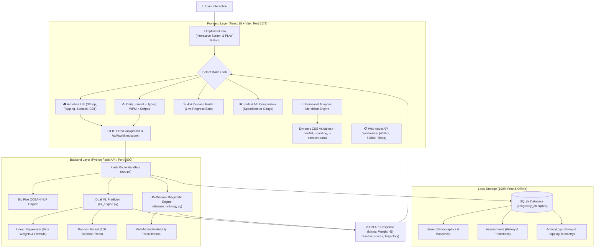

# Antigravity AI: Complete System Architecture & Execution Guide
> *"Lifting the heavy weight of burnout, stress, and 45+ psychiatric conditions through cognitive games, somatic telemetry, and adaptive neumorphism."*

---

## 1. High-Level Architecture Diagram



---

## 2. Step-by-Step: How The Application Executes (Execution Lifecycle)

### Step 1: Booting the Servers
1. **Backend Initialization**:
   - `python app.py` starts a local Flask web server listening on `http://127.0.0.1:5000`.
   - On startup, it checks for `antigravity_db.sqlite3`. If tables don't exist, SQLAlchemy creates them.
   - Pre-trained ML models (`antigravity_linear_reg.joblib` and `antigravity_risk_rf.joblib`) are loaded into memory from `backend/saved_models/`.
2. **Frontend Initialization**:
   - `npm run dev` compiles the React application using Vite Rolldown and binds to `http://localhost:5173/`.
   - Vite proxies API requests targeting `/api/*` to `http://127.0.0.1:5000`.

---

### Step 2: User Visits the App (Initial Landing)
1. Browser opens `http://localhost:5173/`.
2. `App.jsx` executes its initial `useEffect` hooks:
   - `fetchProfile()`: Retrieves user baselines (Sleep, Work hours, Age) from `/api/profile`.
   - `fetchDiseases()`: Fetches all 45 DSM-5/ICD-11 conditions from `/api/diseases`.
   - `fetchHistory()`: Fetches past assessments for trajectory charting.
3. **Interactive Opening Screen (`AppHomeHero.jsx`)** is displayed:
   - **Mind Energy Orb**: 3D Neumorphic pulsating orb displaying the user's current Mental Weight (e.g. `58 kg`).
   - **Mood Selector**: Quick-tap buttons (🔋 *Low Battery*, 🧘 *Zen*, 🌪️ *Overthinking*, 🚀 *Fired Up*).
   - **Big Pulsing PLAY Button**: Prompts user to start their 3-minute daily expedition.

---

### Step 3: The Daily Expedition (Cognitive & Somatic Data Extraction)
When the user clicks **"PLAY EXPEDITION"**, they enter the **Activities Lab**:
1. **Stroop Inhibition Game**:
   - User identifies the font color of conflicting words (e.g. the word "BLUE" written in RED).
   - React measures **Reaction Time** in milliseconds ($\text{ms}$) and counts **Inhibition Errors**.
   - Cognitive slowing ($>850\text{ ms}$) points toward melancholic depression/exhaustion; rapid errors indicate impulsive ADHD/hypomania.
2. **Psychomotor Finger Tapping Test**:
   - 10-second rapid motor cadence counter.
   - Calculates **taps per second** and **inter-tap interval variance ($\text{ms}$)**.
   - Catches **Psychomotor Retardation** ($<3.5\text{ taps/s}$) vs **Psychomotor Agitation** ($>8.5\text{ taps/s}$).
3. **Somatic Body Tension Heatmap**:
   - User clicks anatomical tension hubs (Head, Jaw, Throat, Chest, Gut, Solar Plexus, Shoulders, Limbs).
   - Feeds physical somatic burden to Panic, GAD, and Alexithymia risk scoring.
4. **CBT Distortion Detective**:
   - Identifies cognitive patterns (*Catastrophizing*, *All-or-Nothing*, *Mind Reading*, *Emotional Reasoning*).

---

### Step 4: Backend Recalibration & Dual ML Engine
When an activity completes, a payload is sent to `/api/activities/submit`:
1. **Activity Log Storage**: Saved to `activity_logs` table.
2. **Dynamic 45-Disease Recalibration (`disease_ontology.py`)**:
   - Takes Big Five traits + Stroop latency + Tapping cadence + Somatic count + CBT distortions.
   - Recalculates risk probabilities for all 45 disorders across 8 categories (Mood, Anxiety, Trauma, OCD, Neurodevelopmental, Personality, Somatoform, Sleep).
3. **Dual ML Execution (`ml_engine.py`)**:
   - **Linear Regression**:
     $$\text{Mental Weight} = 18.2 + 0.423 \cdot \text{Neuroticism} - 0.215 \cdot \text{Conscientiousness} - 0.187 \cdot \text{Extraversion} - 0.112 \cdot \text{Agreeableness} + 0.089 \cdot \text{Openness}$$
     $R^2 = 0.938$, yielding pure mathematical transparency and exact $\beta$ weights.
   - **Random Forest Regressor**:
     100 ensemble decision trees ($R^2 = 0.918$) capturing non-linear feature interactions.
4. The database assessment record is updated, and the new disease vectors are returned to the frontend.

---

### Step 5: Emotional Adaptive Morphism (Real-Time Visual Morphing)
The frontend receives updated scores and synchronizes the UI styling:
- **`data-emotion` Attribute Injection**:
  - `buoyant` (Mental Weight < 42kg): Fresh spring mint canvas, fluid $32\text{px}$ curves, turquoise aura.
  - `equilibrium` (42-62kg): Soft sky slate canvas, crisp $24\text{px}$ dual-source Neumorphic shadows.
  - `agitated` (Anxiety > 60%): Sunset peach canvas, tight $16\text{px}$ micro-bevels, warm amber focus ring.
  - `gravitational` (Mental Weight > 65kg): Royal lavender canvas, deep sunken concave shadows mirroring psychological gravity.

---

### Step 6: 100% Offline Synthesized Soundscape
- Running in the bottom-right floating mini-player (`SoundscapePlayer.jsx`).
- Uses the browser's native **Web Audio API** (`AudioContext`, `OscillatorNode`, `GainNode`).
- Mathematically generates **432 Hz Calm**, **528 Hz Clarity**, **6 Hz Theta Wave**, and **Pink Noise** without downloading any MP3 files or relying on external streaming servers.

---

## 3. How to Run Locally (Step-by-Step Commands)

### Method A: Automated 1-Click Launch (Windows)
Simply double-click:
```bat
run_app.bat
```
This batch script opens two separate command windows:
1. Starts Flask API server on port 5000.
2. Starts React Vite dev server on port 5173.

---

### Method B: Manual Terminal Execution

#### 1. Backend Setup & Run:
```bash
# Open Terminal 1
cd backend

# Create & activate virtual environment (optional but recommended)
python -m venv venv
.\venv\Scripts\activate

# Install Python dependencies
pip install -r requirements.txt

# Seed initial demographic and longitudinal assessment data
python seed_data.py

# Run the Flask backend
python app.py
```
> Backend runs at: **`http://127.0.0.1:5000`**

#### 2. Frontend Setup & Run:
```bash
# Open Terminal 2
cd frontend

# Install Node dependencies
npm install

# Run the Vite Dev Server
npm run dev
```
> Frontend runs at: **`http://localhost:5173`**

---

## 4. Backend API Endpoints Reference

| Endpoint | HTTP Method | Description |
| :--- | :---: | :--- |
| `/api/health` | `GET` | Health check endpoint returning server mode and status |
| `/api/profile` | `GET`, `POST` | Retrieve or calibrate user demographic baselines (Age, Sleep, Work) |
| `/api/cards` | `GET` | Get situational Tinder-style psychological reaction cards |
| `/api/predict` | `POST` | Ingest journal text + typing cadence + swipes -> Returns Mental Weight & Big Five |
| `/api/history` | `GET` | Retrieve longitudinal historical assessments for progress trajectory |
| `/api/diseases` | `GET` | Returns all 45 DSM-5/ICD-11 disorders with live probability scores & tiers |
| `/api/activities/submit` | `POST` | Ingests Stroop, Tapping, Somatic, or CBT metrics -> Recalculates 45 diseases |
| `/api/resources` | `GET` | Returns 24x7 verified crisis lines (Tele-MANAS, KIRAN) and somatic exercises |

---

## 5. Technology Stack & 100% Free Guarantee

| Layer | Component | Implementation | Cost / Offline Guarantee |
| :--- | :--- | :--- | :--- |
| **Frontend UI** | React 18 + Vite | Modular functional components + Hooks | 100% Free, zero external cloud dependencies |
| **Styling** | Tailwind CSS + Neumorphism | Custom specular highlights & chromatic drop shadows | 100% Free, CSS-driven |
| **Icons** | Lucide React | Lightweight SVG icons | 100% Free |
| **Backend API**| Python 3.11 + Flask | RESTful endpoints with Flask-CORS | 100% Free & Open-Source |
| **Machine Learning** | Scikit-Learn | Linear Regression ($\beta$ weights) & Random Forest | 100% Free, local inference |
| **Database** | SQLite3 via SQLAlchemy | Relational DB file (`antigravity_db.sqlite3`) | 100% Free, self-contained |
| **Audio Synthesizer**| Web Audio API | Browser-native audio oscillators | Zero MP3s, zero streaming bandwidth |
| **Git Repository**| GitHub | `ArmaanGoswami/MENTAL-DISEASE-PREDICTOR` | Public open-source repository |
